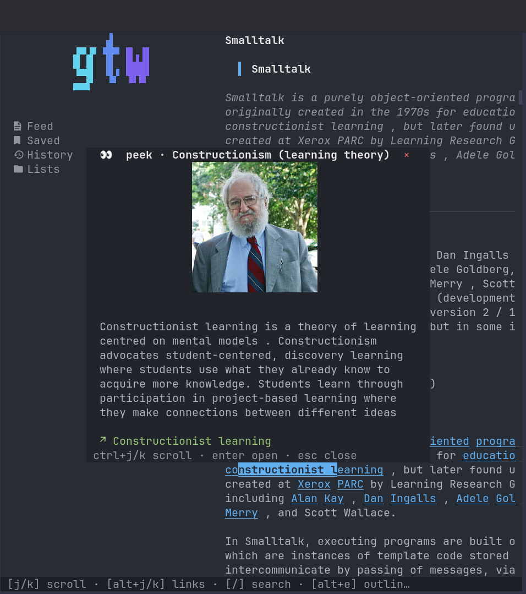

# [gtw](https://github.com/craftty-org/gtw)


<p align="center">
  the missing wikipedia client for the terminal.
  <br />
  <a href="#features">Features</a>
  ·
  <a href="#download">Download</a>
  ·
  <a href="#documentation">Documentation</a>
  ·
  <a href="CONTRIBUTING.md">Contributing</a>
  ·
  <a href="#acknowledgements">Acknowledgements</a>
</p>
<p align="center">

<a href="https://cli.masoko.net/tools/gtw/"></a>
<a href="https://ratatui.rs/"></a>

</p>

`gtw` (goto wikipedia) is a wikipedia reader that runs in your terminal.

## Features

- **Daily feed**: browse featured content, picture of the day, and trending
  articles by date.
- **Search**: find Wikipedia articles quickly from the TUI.
- **Article tabs**: open and switch between multiple articles.
- **Peek**: preview linked articles without leaving the current page.
- **Table of contents**: jump to sections in long articles.
- **Bookmarks and reading lists**: save articles for later and organize them.
- **History**: revisit previously opened articles.
- **Offline mode**: read from local cache with `--offline`.
- **Media support**: images, math, audio, and WebM previews in terminal.
- **Themes and config**: customize appearance and behavior via TOML config.

## Download

### Install script

Install the latest release with the installer script:

```bash
curl -fsSL https://raw.githubusercontent.com/craftty-org/gtw/main/install.sh | bash
```

Or download and inspect it first:

```bash
curl -fsSL https://raw.githubusercontent.com/craftty-org/gtw/main/install.sh -o install.sh
bash install.sh --help
bash install.sh --prefix "$HOME/.local"
```

The installer downloads the matching release archive from GitHub, verifies
checksums when available, and installs `gtw`, man pages, and shell completions.

### AUR (Arch Linux)

Maintained by [vaishnav](https://aur.archlinux.org/account/vaishnav):

```bash
# prebuilt binary
yay -S gtw-bin

# or build from source
yay -S gtw
```

### Build from source

Requirements:

- Rust 1.90+ (edition 2024)
- A C toolchain and platform build prerequisites for native dependencies (see
  [CONTRIBUTING.md](CONTRIBUTING.md))

```bash
# debug build
cargo build

# release build
cargo build --release

# run
cargo run -- --doctor
```

### Install locally

```bash
# install binary, man page, and shell completions
make install
```

## Documentation

- **CLI help**: `gtw --help`
- **Diagnostics**: `gtw --doctor` (prints config/cache paths, media/terminal
  capabilities, and library/cache status without contacting the network)
- **Configuration**: default config path is typically
  `~/.config/gtw/config.toml` (platform-dependent); override with
  `--config <path>`
- **Cache/logs**: default cache directory is typically `~/.cache/gtw/` with logs
  at `~/.cache/gtw/gtw.log` unless `--log-file` is set
- **Project docs**: [README.md](README.md), [CONTRIBUTING.md](CONTRIBUTING.md),
  [CODE_OF_CONDUCT.md](CODE_OF_CONDUCT.md), [Grimoire.toml](Grimoire.toml)

### Manpages

- `gtw(1)` — generated from the CLI (`cargo run -- --man` or `make man`, output
  in `artifacts/man/gtw.1`)

Shell completions can be generated with `gtw --completions <shell>` or via
`make completions`.

## Contributing

See [CONTRIBUTING.md](CONTRIBUTING.md) for development setup, quality gates, and
contribution guidelines.

## Screenshots




## Acknowledgements

- [Wikipedia](https://www.wikipedia.org/) and the
  [Wikimedia](https://www.wikimedia.org/) projects.
- [ratatui](https://ratatui.rs/)
- [crossterm](https://github.com/crossterm-rs/crossterm)
- [tokio](https://tokio.rs/), [reqwest](https://github.com/seanmonstar/reqwest)
- [rusqlite](https://github.com/rusqlite/rusqlite)
- [symphonia](https://github.com/pdeljanov/Symphonia)
- [rodio](https://github.com/RustAudio/rodio)
- [resvg](https://github.com/linebender/resvg)
- [syntect](https://github.com/trishume/syntect)

## Contributors

<!-- CONTRIBUTORS -->
<p align="left">
  <a href="https://github.com/prjctimg"></a> <a href="https://github.com/vaishnav-sabari-girish"></a>
</p>
<!-- /CONTRIBUTORS -->

(c) 2026, [prjctimg](https://prjctimg.me)

Released under the GPL-3.0 license. See [LICENSE](LICENSE) for details.
