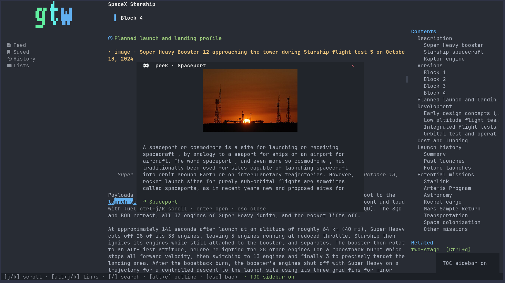

# [gtw](https://github.com/craftty-org/gtw)



<p align="center">
  the missing wikipedia client for the terminal.
  <br />
  <a href="#features">Features</a>
  ·
  <a href="#download">Download</a>
  ·
  <a href="#documentation">Documentation</a>
  ·
  <a href="CONTRIBUTING.md">Contributing</a>
  ·
  <a href="#acknowledgements">Acknowledgements</a>
</p>

`gtw` (goto wikipedia) is a wikipedia reader that runs in your terminal.

## Features

- **TUI reading**: keyboard-driven browsing, search, daily feed, and tabbed article reading.
- **Offline library**: local cache, bookmarks, history, reading lists, and `--offline` mode.
- **Rich content**: terminal rendering for article content, images, math, audio, and WebM previews.
- **Configurable**: TOML config, themes, optional effects, and `gtw --doctor` diagnostics.

## Download

### Install script

Install the latest release with the installer script:

```bash
curl -fsSL https://raw.githubusercontent.com/craftty-org/gtw/main/install.sh | bash
```

Or download and inspect it first:

```bash
curl -fsSL https://raw.githubusercontent.com/craftty-org/gtw/main/install.sh -o install.sh
bash install.sh --help
bash install.sh --prefix "$HOME/.local"
```

The installer downloads the matching release archive from GitHub, verifies
checksums when available, and installs `gtw`, man pages, and shell completions.

### AUR (Arch Linux)

Maintained by [vaishnav](https://aur.archlinux.org/account/vaishnav):

```bash
# prebuilt binary
yay -S gtw-bin

# or build from source
yay -S gtw
```

### Build from source

Requirements:

- Rust 1.90+ (edition 2024)
- A C toolchain and platform build prerequisites for native dependencies (see
  [CONTRIBUTING.md](CONTRIBUTING.md))

```bash
# debug build
cargo build

# release build
cargo build --release

# run
cargo run -- --doctor
```

### Install locally

```bash
# install binary, man page, and shell completions
make install
```

## Documentation

- **CLI help**: `gtw --help`
- **Diagnostics**: `gtw --doctor` (prints config/cache paths, media/terminal
  capabilities, and library/cache status without contacting the network)
- **Configuration**: default config path is typically
  `~/.config/gtw/config.toml` (platform-dependent); override with
  `--config <path>`
- **Cache/logs**: default cache directory is typically `~/.cache/gtw/` with logs
  at `~/.cache/gtw/gtw.log` unless `--log-file` is set
- **Project docs**: [README.md](README.md), [CONTRIBUTING.md](CONTRIBUTING.md),
  [CODE_OF_CONDUCT.md](CODE_OF_CONDUCT.md), [Grimoire.toml](Grimoire.toml)

### Manpages

- `gtw(1)` — generated from the CLI (`cargo run -- --man` or `make man`, output
  in `artifacts/man/gtw.1`)

Shell completions can be generated with `gtw --completions <shell>` or via
`make completions`.

### Dependencies

`gtw` is built with Rust and uses a set of crates for TUI, networking, caching,
parsing, and media/rendering. Key direct dependencies include:

- **TUI/runtime**: `ratatui`, `crossterm`, `tachyonfx`, `tuikit`, `tokio`
- **Networking & data**: `reqwest`, `serde`/`serde_json`, `toml`, `rusqlite`
- **Parsing/rendering**: `scraper`, `syntect`, `unicode-width`, `image`,
  `resvg`, `ratatui-image`, `ratex-*`
- **Media**: `symphonia`, `rodio`, `zvidlib`

For the complete and authoritative dependency list (including versions and
features), see [Cargo.toml](Cargo.toml) and [Cargo.lock](Cargo.lock).

## Contributing

Contributions, bug reports, and focused patches are welcome. Please read
[CONTRIBUTING.md](CONTRIBUTING.md) and [CODE_OF_CONDUCT.md](CODE_OF_CONDUCT.md)
before contributing.

Key project expectations include:

- Rust 1.90+ (edition 2024)
- Passing quality gates: `cargo fmt --check`,
  `cargo clippy --all-targets --all-features -- -D warnings`,
  `cargo test --workspace`, `cargo deny check`
- No live network in tests
- No FFmpeg/runtime FFmpeg dependency
- Keep the UI thread non-blocking and use explicit loading/activity states

## Screenshots

Screenshots are not yet included in this repository.

## Acknowledgements

- [Wikipedia](https://www.wikipedia.org/) and the
  [Wikimedia](https://www.wikimedia.org/) projects for the knowledge and content
  this client is designed to read.
- The Rust and open-source ecosystem, including libraries used by this project
  such as [ratatui](https://ratatui.rs/),
  [crossterm](https://github.com/crossterm-rs/crossterm),
  [tokio](https://tokio.rs/), [reqwest](https://github.com/seanmonstar/reqwest),
  [rusqlite](https://github.com/rusqlite/rusqlite),
  [symphonia](https://github.com/pdeljanov/Symphonia),
  [rodio](https://github.com/RustAudio/rodio),
  [resvg](https://github.com/linebender/resvg), and
  [syntect](https://github.com/trishume/syntect).

## Contributors

<!-- CONTRIBUTORS -->
<p align="left">
  <a href="https://github.com/prjctimg"></a> <a href="https://github.com/vaishnav-sabari-girish"></a>
</p>
<!-- /CONTRIBUTORS -->

(c) 2026, [prjctimg](https://prjctimg.me)

Released under the GPL-3.0 license. See [LICENSE](LICENSE) for details.
